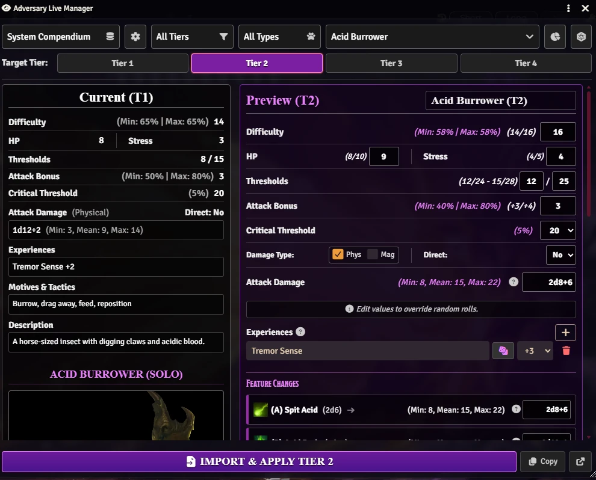
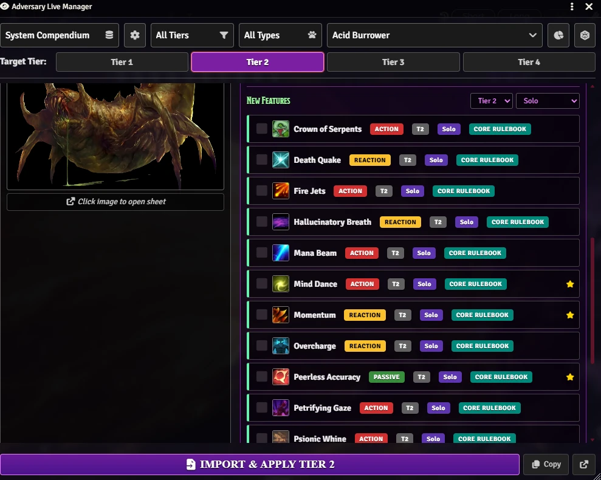
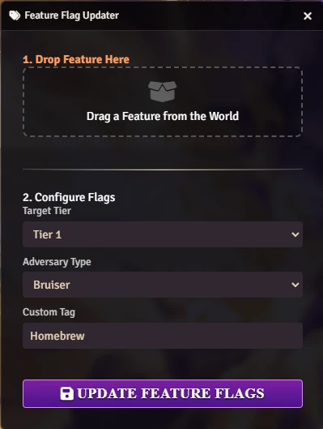
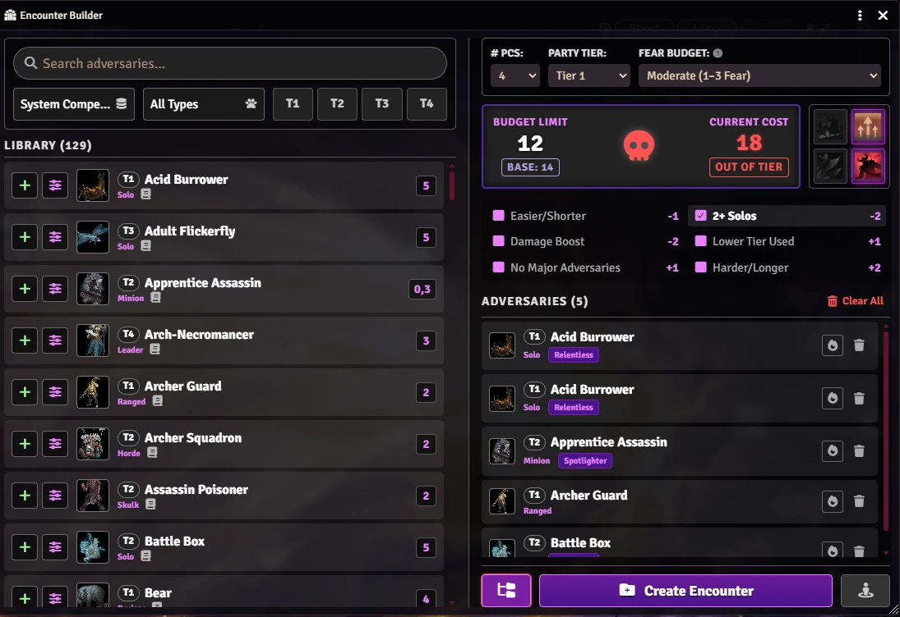
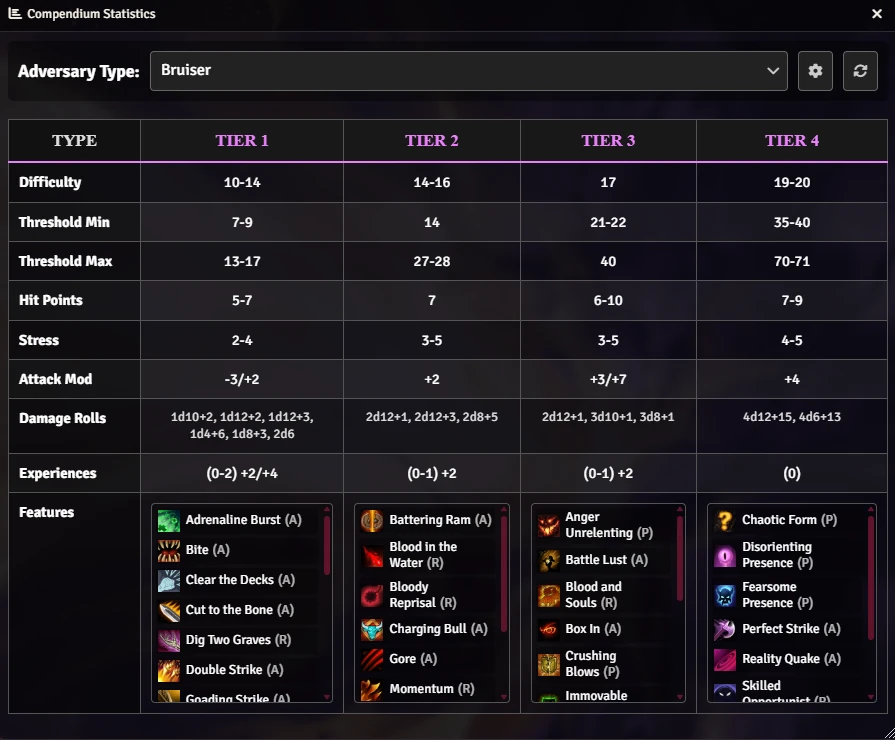
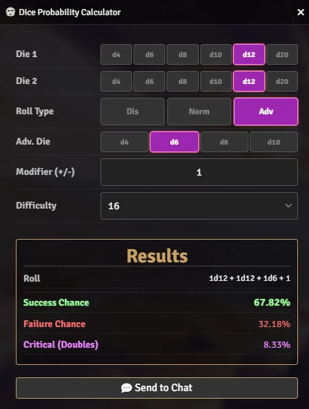
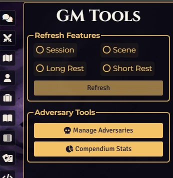

# 💀 Daggerheart: Adversary Manager

Moving an adversary from Tier 1 to Tier 3 means recalculating its HP, Stress, Difficulty, thresholds, attack and damage by hand, and then checking the features it should have at the new tier.

Adversary Manager does that math for you. Select one or more adversary tokens, pick the target tier, compare the current and new stats side by side, adjust any value, and apply. The module also builds encounters within the Battle Point budget, shows the stat ranges of every adversary type in the compendium, and calculates dice odds.

<p align="center"></p>

<p align="center"></p>

[](https://buymeacoffee.com/mestredigital) [](https://mestredigital.online/pages/projetos-en)

## What it does

### Adversary scaling

Any adversary can be moved to any tier from 1 to 4, using the benchmarks for its type. Before anything changes, the window shows the current stats next to the stats for the target tier.

- HP, Stress, Difficulty and damage thresholds are recalculated.
- Attack modifiers and damage formulas are scaled.
- Experience values go up or down with the tier difference.
- The features available for the target tier and type are listed, and you tick the ones to add. Nothing is added on its own.
- Any value in the preview (HP, damage and so on) can be edited by hand before you apply.
- With several tokens selected on the canvas, all of them are updated at once.
- Adversaries can be imported from a compendium into your world and scaled in the same step.

### Feature management

<p align="center"></p>

- Your homebrew features can be added to the manager, so it offers them when scaling.
- The Feature Flag Updater is a drag-and-drop window where you set the tier, adversary type and a custom tag of the feature items in your world.
- All the features of the adversaries in a compendium can be imported at once.

### Encounter builder

<p align="center"></p>

- Search world actors and the system compendiums, filtered by tier and type.
- The Battle Point budget is calculated from the party size and tier, and the window shows the current cost against it.
- Adversaries with Summoner, Spotlighter, Momentum, Terrifying or Relentless features are detected, and their combination changes the difficulty estimate.
- The estimate updates as you build: Very Easy, Easy, Balanced, Challenging, Hard, Deadly or Out of Tier.
- Damage boosts can be applied to individual units, and the difficulty can be adjusted by hand with Easier or Harder.
- When the list is ready, place the tokens on the scene (hidden by default) or put the actors in a folder.

### Compendium statistics

<p align="center"></p>

- For each adversary type, the window shows statistics across the four tiers.
- The tables give the ranges of Difficulty, HP, Stress, thresholds, attack modifiers and damage rolls.
- Each tier lists the features found in the compendium. Click one to open it, or drag it onto an actor sheet.
- You can add more compendiums to the statistics.
- The system compendium ships pre-calculated, so the window does not read every adversary each time it opens. Your own compendiums are still read live and merged in.

### Dice probability calculator

<p align="center"></p>

- The chances of success, failure and a critical are calculated as you change the options.
- Two modes: Duality Dice (2d12, with doubles as criticals), or a d20 roll with a critical threshold you choose.
- Advantage, Disadvantage and flat modifiers are supported.
- With an adversary token selected, its Difficulty is filled in.
- The result can be sent to chat as a card.

## Usage

Open each tool (Adversary Manager, Encounter Builder, Compendium Stats and Dice Probability) with its button in the Daggerheart system menu or in the Actors directory.

<p align="center"></p>

You can also use macros to access the API:

```js
// Adversary Manager (Live or Batch based on selection)
AM.Manage();
```

```js
// Encounter Builder
AM.EncounterBuilder();
```

```js
// Compendium Stats
AM.CompendiumStats();
```

```js
// Dice Probability
AM.DiceProbability();
```

```js
// Rebuild the pre-calculated statistics after a Daggerheart update, then save the
// downloaded file over data/compendium-stats-core.json. The Compendium Stats window
// tells you when this is needed.
AM.BuildStatsSnapshot();
```

## Instructions

- [How to Import Features from an Adversary Compendium](https://github.com/brunocalado/daggerheart-advmanager/wiki/How-to-Import-Features-from-an-Adversary-Compendium).

- [How to Add Your Features to the Manager](https://github.com/brunocalado/daggerheart-advmanager/wiki/How-to-Add-Your-Features-to-the-Manager).

Learn more at [WIKI](https://github.com/brunocalado/daggerheart-advmanager/wiki).

## Translations

The module ships in English. To translate it, open an [issue](https://github.com/brunocalado/daggerheart-advmanager/issues) and attach a translated copy of [lang/en.json](lang/en.json), with the code of your language (for example `fr`, `de` or `pt-BR`). I add the file to the module in the next update. To update a translation later, do the same with the new file.

## Installation

Install via the Foundry VTT Module browser or use this manifest link:

```js
https://github.com/brunocalado/daggerheart-advmanager/releases/latest/download/module.json
```

## Changelog

You can read the full history of changes in the [CHANGELOG](CHANGELOG.md).

## ⚖️ Credits and License

* **Code License:** [GNU GPLv3](LICENSE).

* [skull](https://unsplash.com/license)

**Disclaimer:** This module is an independent creation and is not affiliated with Darrington Press.

# 🧰 My Daggerheart Modules

| Module | Description |
| :--- | :--- |
| 💀 [**Adversary Manager**](https://github.com/brunocalado/daggerheart-advmanager) | Scale adversaries instantly and build balanced encounters. |
| 🖼️ [**Art Mapper**](https://github.com/brunocalado/dh-assets) | Automatically assigns artwork to system compendiums, actors, tokens, and custom module content — keeping your visuals organized and up to date. |
| 🐉 [**Colossus**](https://github.com/brunocalado/dh-colossus) | Manage massive multi-part boss encounters with independent HP per part and a single shared stress pool. |
| 📦 [**Containers**](https://github.com/brunocalado/dh-containers) | Group inventory items into collapsible containers — pouches, chests, backpacks — to declutter character sheets. |
| 💥 [**Critical**](https://github.com/brunocalado/daggerheart-critical) | Animated criticals. |
| 💠 [**Custom Stat Tracker**](https://github.com/brunocalado/dh-new-stat-tracker) | Add custom trackers to actors. |
| ☠️ [**Death Moves**](https://github.com/brunocalado/daggerheart-death-moves) | Enhances the Death Move moment with a dramatic interface and full automation. |
| 📏 [**Distances**](https://github.com/brunocalado/daggerheart-distances) | Visualizes combat ranges with customizable rings and hover calculations. |
| 📦 [**Extra Content**](https://github.com/brunocalado/daggerheart-extra-content) | Homebrew content pack. |
| 😱 [**Fear Tracker**](https://github.com/brunocalado/daggerheart-fear-tracker) | Adds an animated slider bar with configurable fear tokens to the UI. |
| 🧟 [**Horde**](https://github.com/brunocalado/dh-horde) | Explode single horde tokens into dozens of individual tokens and manage their movement and stats automatically. |
| 🎁 [**Mystery Box**](https://github.com/brunocalado/dh-mystery-box) | Introduces mystery box mechanics for random loot and surprises. |
| ⚡ [**Quick Actions**](https://github.com/brunocalado/daggerheart-quickactions) | Quick access to common mechanics like Falling Damage, Downtime, etc. |
| 📜 [**Quick Rules**](https://github.com/brunocalado/daggerheart-quickrules) | Fast and accessible reference guide for the core rules. |
| 🤖 [**Resource Macros**](https://github.com/brunocalado/daggerheart-fear-macros) | Automatically executes macros when the Fear, Hope, Stress, HP, or Armor resources change. |
| 🎲 [**Stats**](https://github.com/brunocalado/daggerheart-stats) | Tracks dice rolls from GM and Players. |
| 🧠 [**Stats Toolbox**](https://github.com/brunocalado/dh-statblock-importer) | Import actors using a statblock. |
| 🛒 [**Store**](https://github.com/brunocalado/daggerheart-store) | A dynamic, interactive, and fully configurable in-game store. |
| 🔍 [**Unidentified**](https://github.com/brunocalado/dh-unidentified) | Obfuscates item names and descriptions until they are identified by the players. |
| 🌌 [**Void**](https://github.com/brunocalado/the-void-unofficial) | Unofficial module that brings The Void playtesting content — experimental classes, subclasses, ancestries, communities, adversaries, loot, weapons, and more. |

# 🗺️ Adventures

| Adventure | Description |
| :--- | :--- |
| ✨ [**I Wish**](https://github.com/brunocalado/i-wish-daggerheart-adventure) | A wealthy merchant is cursed; one final expedition may be the only hope. |
| 💣 [**Suicide Squad**](https://github.com/brunocalado/suicide-squad-daggerheart-adventure) | Criminals forced to serve a ruthless master in a land on the brink of war. |